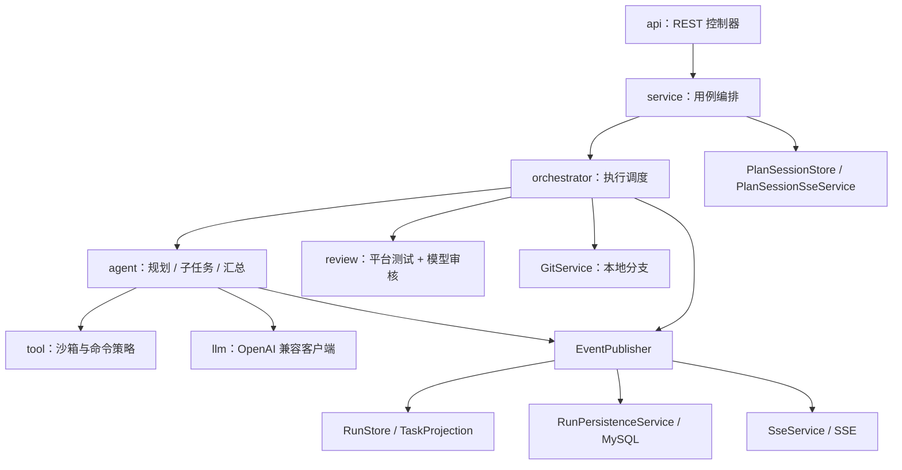
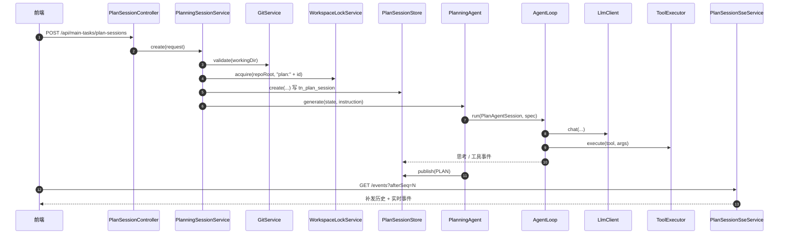
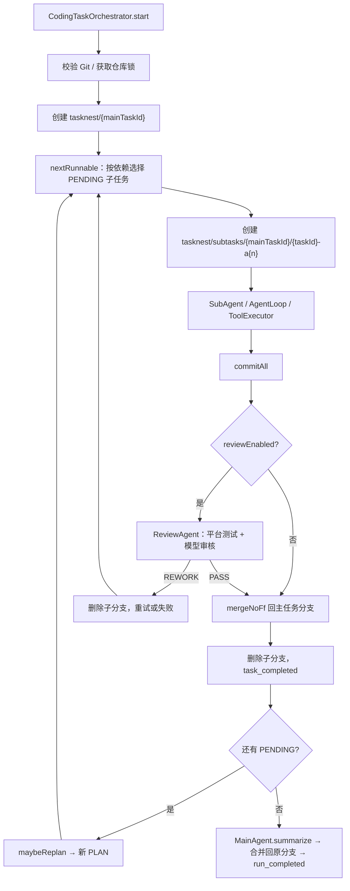
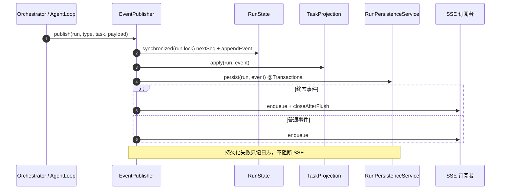

# TaskNest 后端代码导读

本文解释 `backend` 当前实现的结构与调用逻辑，帮助第一次接手的人快速定位代码。
**事件字段以 [`docs/events.md`](../docs/events.md) 为准，REST / 功能契约以
[`docs/requirements.md`](../docs/requirements.md) 为准，Agent / Git / 审核设计见
[`docs/p3-agent-platform.md`](../docs/p3-agent-platform.md)。** 本文只做实现导读，不重复
定义契约。

- [根 README](../README.md)
- [事件契约](../docs/events.md)
- [P3 Agent 平台设计](../docs/p3-agent-platform.md)
- [需求文档](../docs/requirements.md)
- [协作约束](../CLAUDE.md)

## 1. 这份文档怎么读

按目标选择路径，不必从头到尾读：

| 目标 | 建议顺序 |
| --- | --- |
| 看懂一个 REST 请求 | `api/*Controller` → `service/*Service` → 对应 `orchestrator` |
| 看懂创建前的规划 | `PlanSessionController` → `PlanningSessionService` → `PlanningAgent` → `AgentLoop` → `PlanSessionStore` |
| 看懂真实执行 | `RunService` → `CodingTaskOrchestrator` → `SubAgent` / `AgentLoop` → `ToolExecutor` / `ReviewAgent` / `GitService` |
| 看懂事件与前端推送 | `EventPublisher` → `TaskProjection` → `RunPersistenceService` / `SseService` |
| 看懂数据库档案 | `schema.sql` → `persistence/entity` → `RunPersistenceService` / `MainTaskQueryService` |

## 2. 技术栈与启动

| 项 | 版本 / 说明 |
| --- | --- |
| Spring Boot | 3.3.5 |
| Java | 17（开发环境用 Java 21 运行） |
| Web | Spring MVC + Jakarta Bean Validation |
| 持久化 | MyBatis-Plus 3.5.9 + MySQL 8 |
| 测试 | JUnit 5 + AssertJ + H2 `MODE=MySQL` |
| 实时通道 | SSE（运行事件 / 规划会话） |
| 模型 | 项目内 OpenAI 兼容 `/chat/completions` 客户端，不使用 Spring AI |

```bash
cd backend

# 单元 / 集成测试：H2，不依赖本机 MySQL
mvn test

# 启动：默认 127.0.0.1:8080
mvn spring-boot:run
```

数据源只从环境变量读取，密码不要写进项目文件：

```bash
export TASKNEST_MYSQL_HOST=<host>
export TASKNEST_MYSQL_PORT=3306
export TASKNEST_MYSQL_DB=task_nest
export TASKNEST_MYSQL_USERNAME=<user>
export TASKNEST_MYSQL_PASSWORD=<password>
```

`TASKNEST_MYSQL_*` 优先，未设置时回退到 `MYSQL_*`；再回退到
`127.0.0.1:3306/task_nest`。建表由 `src/main/resources/schema.sql` 在启动时执行。
测试 profile 见 `src/test/resources/application-test.yml`。

## 3. 分层与目录结构



| 包 | 职责 | 代表类 |
| --- | --- | --- |
| `api` | REST 边界，只做校验与转发 | `MainTaskController`、`PlanSessionController`、`RunController` |
| `api.dto` | 请求 / 响应 record | `CreatePlanSessionRequest`、`MainTaskDetail` |
| `common` | 响应信封、异常、错误码 | `ApiResponse`、`ErrorCode`、`GlobalExceptionHandler` |
| `config` | 属性绑定、执行器、CORS | `TaskNestProperties`、`ExecutorConfig`、`WebConfig` |
| `event` | 17 种事件、信封、发布管线 | `EventEnvelope`、`EventPayload`、`EventPublisher` |
| `orchestrator` | 执行抽象与真实编排 | `CodingTaskOrchestrator`、`GitService` |
| `orchestrator.agent` | Agent 循环、规划、子任务、汇总 / 重排 | `AgentLoop`、`PlanningAgent`、`SubAgent`、`MainAgent`、`PlanParser` |
| `orchestrator.llm` | OpenAI 兼容聊天与工具调用 | `LlmClient` |
| `orchestrator.review` | 平台测试、审核 Agent、结论强制 | `ReviewAgent`、`ReviewTestRunner` |
| `orchestrator.tool` | 工具执行、工作区沙箱、命令策略 | `ToolExecutor`、`WorkspaceSandbox`、`CommandPolicy` |
| `persistence` | 事件落库、档案查询 | `RunPersistenceService`、`MainTaskQueryService` |
| `persistence.entity` | `tn_*` 表实体 | `MainTaskEntity`、`SubtaskEntity`、`TaskReviewEntity` |
| `persistence.mapper` | MyBatis-Plus Mapper | `MainTaskMapper` 等 |
| `persistence.service` | 实体级 `IService` | `MainTaskEntityService` 等 |
| `persistence.service.impl` | 默认 `ServiceImpl` | `MainTaskEntityServiceImpl` 等 |
| `service` | 运行 / 规划会话 / 计划 / 设置 / 锁 | `RunService`、`PlanningSessionService`、`PlanSessionStore` |
| `sse` | 连接、补发、心跳、关闭 | `SseService`、`SseConnection`、`PlanSessionSseService` |
| `store` | 内存运行状态与两层任务投影 | `RunStore`、`RunState`、`TaskProjection` |

依赖方向：`api → service → orchestrator → agent/tool/llm/review/git`；
`event`、`sse`、`persistence` 是被编排层与用例层共同使用的横切设施。
`store` 只保存内存态，不反向依赖 `api`。

## 4. 启动装配与配置

`TaskNestApplication` 做三件事：扫描 `com.tasknest` 组件、绑定 `tasknest.*` 配置、
注册 `persistence.mapper` 下的 MyBatis-Plus Mapper。

三个执行器（`ExecutorConfig`）按用途隔离，避免互相阻塞：

| Bean | 类型 | 用途 |
| --- | --- | --- |
| `orchestrationExecutor` | cached thread pool | 规划会话与真实运行的后台任务 |
| `sseDispatcher` | cached thread pool | 每个 SSE 连接的有序发送任务 |
| `taskNestScheduler` | scheduled pool（2 线程） | SSE 心跳 |

配置来源：

- `application.yml`：端口、数据源、MyBatis-Plus、SSE 超时 / 心跳。
- `TaskNestProperties`：绑定 `tasknest.sse.timeout-ms`、`tasknest.sse.heartbeat-ms`。
- `WebConfig`：只放行 `localhost` / `127.0.0.1` 任意端口的 `/api/**`，
  方法为 GET / POST / PUT / OPTIONS。
- `schema.sql`：13 张 `tn_*` 表，MySQL 与 H2 共用，全部使用
  `CREATE TABLE IF NOT EXISTS`。

LLM 与审核设置不是 `application.yml` 配置，而是 MySQL 单例表 + 运行时快照，见第 6.8 节。

## 5. 核心模型

### 5.1 两层任务

只允许一个主任务 + 其直属子任务，不存在更深层级。主任务与子任务分开建模、分开落表：

| 状态枚举 | 取值 |
| --- | --- |
| `MainTaskStatus` | `PENDING` / `RUNNING` / `WAITING_INPUT` / `COMPLETED` / `FAILED` |
| `SubtaskStatus` | `PENDING` / `RUNNING` / `WAITING_INPUT` / `RETRYING` / `REVIEWING` / `SUCCESS` / `FAILED` / `CANCELLED` |
| `RunStatus` | `RUNNING` / `COMPLETED` / `FAILED` |
| `PlanSessionStatus` | `RUNNING` / `WAITING_INPUT` / `READY` / `CONFIRMED` / `CANCELLED` / `FAILED` |

`MainTaskState` / `TaskNodeState` 是内存投影，`RunSnapshot` 是返回给前端的
`run + mainTask + subtasks + events` 快照，不再返回递归任务树。

### 5.2 事件信封

```json
{
  "eventId": "evt_000001",
  "runId": "run_20261021_141831_abc123",
  "seq": 1,
  "type": "plan",
  "timestamp": "2026-10-21T14:18:31.000Z",
  "task": { "taskId": "plan_root", "parentTaskId": null, "title": "规划", "agentName": "planner" },
  "payload": {}
}
```

- `seq` 从 1 严格递增，心跳也占号。
- 规划会话的 `runId = planSessionId`，根任务固定为 `plan_root`。
- 终态事件只有 `RUN_COMPLETED` 与 `ERROR`。
- 17 种事件及字段见 [`docs/events.md`](../docs/events.md)。

## 6. 调用链

### 6.1 规划会话

入口：`POST /api/main-tasks/plan-sessions`，请求为 `goal + workingDir`。



关键步骤：

1. `PlanningSessionService.create` 调用 `GitService.validate` 确认工作目录是干净、
   非 detached 的 Git 仓库根目录。
2. `WorkspaceLockService.acquire(root, "plan:"+id)` 保证同一仓库同时只有一个规划 / 运行。
3. `PlanSessionStore.create` 创建内存 `PlanSessionState` 并插入 `tn_plan_session`
   （状态 `RUNNING`）。
4. 创建成功后提交到 `orchestrationExecutor`，由 `PlanningAgent` 启动只读 Agent 循环。
5. `PlanningAgent` 使用 `WorkspaceSandbox` + `ToolExecutor` + `AgentLoop`，工具限制为
   `fs.list` / `fs.find` / `fs.read` / `ask_user`，最多 30 轮。
6. 模型输出经 `PlanParser.parse` 校验：两层结构、任务 ID 唯一、工具已知、依赖存在且无环。
7. `PlanSessionStore.publish` 分配 seq、更新会话状态、写 `tn_plan_session_event`、
   更新 `tn_plan_session`，再投递 SSE；计划就绪后状态变为 `READY`。

其他入口：

| 操作 | 调用链 |
| --- | --- |
| 用户回答 | `POST /{id}/inputs` → `InputValidation` → `waiting.queue.offer` → `PlanAgentSession` 发布 `INPUT_RECEIVED` 并继续 |
| 计划修订 | `POST /{id}/revisions` → 仅 `READY` 可修订 → 状态回 `RUNNING` → 重新运行 `PlanningAgent`，`revision` 递增 |
| 确认 | `POST /{id}/confirm` → 重新校验 Git → 释放仓库锁 → `RunService.createFromPlan` → 发送终态 `RUN_COMPLETED` 并关闭 SSE |
| 取消 | `POST /{id}/cancel` → 非终态置 `CANCELLED` → 释放锁 → 关闭 SSE |

SSE 连接由 `PlanSessionSseService.connect` 建立：校验 `0 <= afterSeq <= lastSeq`，
先补发 `seq > afterSeq` 的历史事件，再加入订阅者并立即发一次心跳；终态连接在
flush 后关闭。

### 6.2 确认计划并创建主任务

```text
PlanSessionController.confirm(planSessionId)
  → PlanningSessionService.confirm
      → 校验状态 READY 且 plan 非空
      → GitService.validate(workingDir)
      → WorkspaceLockService.release(root, "plan:"+id)
      → RunService.createFromPlan(draft, revision, workingDir, repo.branch())
          → 生成 mainTaskId / runId / mainTaskBranch = "tasknest/" + mainTaskId
          → PlanDraftService.fromConfirmed(...)
          → RunPersistenceService.createPending(...)   // tn_main_task + tn_main_task_workspace
          → PlanDraftService.save(...)                 // tn_main_task_plan
          → TaskOrchestrator.start(runId, RunRequest)  // @Primary CodingTaskOrchestrator
      → 会话置 CONFIRMED，发布 RUN_COMPLETED，关闭规划 SSE
```

保存计划或启动编排失败时，`RunPersistenceService.markStartFailed` 会把主任务标记为失败，
避免留下一直 `PENDING` 的档案。

### 6.3 运行入口

| 入口 | 调用链 | 说明 |
| --- | --- | --- |
| 规划会话确认 | `POST /api/main-tasks/plan-sessions/{id}/confirm` | **执行的唯一入口**，创建主任务并启动真实 Agent |

`RunService` 注入的是 `TaskOrchestrator` 接口，Spring 注入唯一的
`CodingTaskOrchestrator`。

### 6.4 真实执行



关键步骤：

1. `start` 校验计划、工作目录、原始分支；再次确认当前分支未漂移，获取仓库锁，
   在 `RunStore` 创建 `RunState`，提交后台执行。
2. `execute` 发布 `RUN_STARTED` 与 `PLAN`，创建并切换到主任务分支
   `tasknest/<mainTaskId>`，发布根任务 `TASK_STARTED`。
3. 读取 `AgentSettingsService.current()`，计算尝试预算：
   `attemptBudget = reviewEnabled ? 1 + reviewMaxReworks : 2`。
   开启审核时预算包含首次实现 + 返工；关闭审核时保留一次瞬时错误重试。
4. `nextRunnable` 按计划顺序扫描直属子任务，跳过非 `PENDING` 节点，要求所有
   `dependsOn` 已 `SUCCESS`；子任务串行执行，不做并行。
5. `runSubtask` 每次尝试都从主任务分支 HEAD 创建
   `tasknest/subtasks/<mainTaskId>/<taskId>-a<n>`。该命名与 `tasknest/<mainTaskId>`
   同级，因为 Git ref 不能同时是文件与目录。
6. `SubAgent` 组装提示词并运行 `AgentLoop`，工具调用经 `ToolExecutor`：
   文件操作受 `WorkspaceSandbox` 限制，Shell 受 `CommandPolicy` 限制，输出中的密钥被脱敏。
7. Agent 给出完成摘要后执行 `git add -A` 并提交；无变化时记录 `noChanges=true`，
   不创建空提交。
8. 审核开启时进入 `ReviewAgent`。`PASS` 后把子任务分支 `--no-ff` 合并回主任务分支，
   删除子分支并发布 `task_completed`。`REWORK` 时丢弃本次子分支，携带审核意见重试；
   预算耗尽则子任务失败并终止运行。
9. 每个子任务成功合并后、下一个子任务开始前是重排窗口：`maybeReplan` 让主 Agent
   判断是否调整未开始的 `PENDING` 任务，见 6.6。
10. 所有子任务成功后，`MainAgent.summarize` 生成汇总；切回原始分支，把主任务分支
    `--no-ff` 合并回去，删除主任务分支，发布根任务 `task_completed` 与 `run_completed`。

失败语义：

- 子任务失败：删除当前子任务分支；可重试时发布 `task_failed(retryable=true)`，
  从主任务分支重建；最终失败则停止后续任务。
- 运行失败：切回原始分支，删除主任务分支及残留子任务分支，发布 `ERROR`。
- 合并冲突：执行 `git merge --abort`，**保留**双方分支与提交现场，发布
  `error(GIT_MERGE_CONFLICT)`，不自动 reset。
- 运行期间检测到用户手动切换分支：`GIT_BRANCH_DRIFT`，停止，不自动纠正。

### 6.5 审核

```text
CodingTaskOrchestrator.runSubtask
  → 发布 review_started，子任务进入 REVIEWING
  → ReviewAgent.review
      → 若已取消，直接返回 cancelled，不执行测试
      → ReviewTestRunner.run
          → 使用计划行 testCommand，未提供时自动探测
            （package.json / pom.xml / gradlew / go.mod / Cargo.toml / pytest）
          → ReviewCommandPolicy 只允许测试 / lint / build / 类型检查 / 只读 Git
          → ToolExecutor 以 REVIEW 模式执行，超时 600s
          → 测试前后对比 git status，新增改动视为工作区副作用
      → 组装审核上下文（需求、验收标准、变更文件、工具记录、测试证据）
      → LlmClient 输出严格 JSON，最多 2 次
      → enforce：平台证据优先
          - 测试 FAILED / 超时 → 强制 REWORK
          - 产生工作区副作用 → REWORK
          - BLOCKER / MAJOR → REWORK
          - 有源码变更但测试 UNAVAILABLE → REWORK
  → 发布 review_completed(verdict, issues, testEvidence)
  → PASS 合并；REWORK 删除子分支并重试
```

审核 Agent 没有文件写工具；它的 Shell 也走更窄的 `ReviewCommandPolicy`。
审核结论写入 `tn_task_review`，失败只记日志，不阻断已有合并结果。

### 6.6 动态重排

```text
CodingTaskOrchestrator.maybeReplan
  → MainAgent.considerReplan（只读工具，可 ask_user）
      → 返回 {"action":"continue"} 或 {"action":"replan", reason, tasks}
  → PlanParser.parse(...) 解析新计划
  → PlanRevisionService.revise(currentPlan, statusSnapshot, draft, reason)
      → 只能新增任务、修改 / 删除 PENDING 子任务
      → 校验依赖存在、无环、不能依赖 CANCELLED
      → revision 递增，记录 changedTaskIds
  → EventPublisher 发布新的 PLAN
      → TaskProjection / RunPersistenceService 把被移除的 PENDING 标记 CANCELLED
  → PlanDraftService.applyRuntimePlan 更新 tn_main_task_plan（失败只记日志）
```

`RUNNING` / `WAITING_INPUT` / `REVIEWING` / `SUCCESS` / `FAILED` 子任务不可修改。
重排失败被吞掉并保留旧计划，不阻断已完成的子任务。

### 6.7 事件、SSE 与持久化



`EventPublisher.publish` 的顺序固定为：分配 seq → 内存事件列表 → `TaskProjection`
更新主 / 子任务状态 → `RunPersistenceService` 落库 → SSE 队列。终态事件在入队后
flush 并关闭订阅者。

`SseService.connect(runId, afterSeq)`：

1. 从 `RunStore` 取运行；校验 `0 <= afterSeq <= lastSeq`。
2. 新建 `SseConnection`，把重放边界设为当前 `lastSeq`。
3. 补发 `seq > afterSeq` 的历史事件，再加入订阅者并启动发送循环。
4. 立即发布一次心跳；非终态运行注册 15s 固定频率心跳，终态运行 flush 后关闭。
5. `SseConnection` 用单队列 + 单发送任务保证同一连接内有序；发送
   `id=eventId`、`name=type`、`data=JSON`。断线、超时或完成后只清理一次。

规划会话使用独立的 `PlanSessionSseService`，语义相同，但状态源是 `PlanSessionState`，
事件写 `tn_plan_session_event`，不写 `tn_event`。

### 6.8 设置

| 接口 | 服务 | 存储 | 说明 |
| --- | --- | --- | --- |
| `GET/PUT /api/settings/llm` | `LlmSettingsService` | `tn_llm_setting` + `tn_llm_setting_model` | Base URL、模型名、`LITERAL` / `ENV` 密钥 |
| `GET/PUT /api/settings/agent` | `AgentSettingsService` | `tn_agent_setting` | 审核开关、最大返工次数 0–5 |

两个服务都在 `@PostConstruct` 启动加载，保存后立即替换 `volatile` 运行时快照：

- LLM 默认 `https://api.openai.com/v1`、`gpt-4o`、`ENV` + `OPENAI_API_KEY`。
- `LITERAL` 密钥写入数据库，但读取接口只返回掩码；日志不输出密钥。
- `ENV` 模式只保存变量名，`resolveApiKey()` 在调用时从进程环境解析。
- 审核默认开启、最多返工 2 次；`CodingTaskOrchestrator` 每次运行读取当前快照。

### 6.9 历史档案

- `GET /api/main-tasks?limit=50` → `MainTaskQueryService.list`：按 `created_at DESC`
  查 `tn_main_task`，批量补计划版本与工作目录，统计子任务总数 / 成功数。
- `GET /api/main-tasks/{id}` → `MainTaskQueryService.detail`：主任务、子任务、提示词、
  中间结果、事件、计划、工作目录；事件从 `event_json` 还原为 JSON 节点。
- 档案查询以 MySQL 为准，不依赖 `RunStore`；前端打开历史条目时不建立 SSE。

### 6.10 目录浏览

`GET /api/fs/directories?path=&showHidden=false` → `DirectoryBrowserService.list`：
空路径返回用户主目录，规范化并解析真实路径，只列目录（不读文件内容），最多 500 条，
同时返回父目录与文件系统根。浏览器 `showDirectoryPicker()` 拿不到绝对路径，因此工作
目录选择走后端。

## 7. 关键类索引

| 类 | 包 | 职责 | 被谁调用 | 下一步 |
| --- | --- | --- | --- | --- |
| `MainTaskController` | `api` | 主任务列表 / 详情、已保存计划修订 | 前端 | `PlanDraftService` / `MainTaskQueryService` |
| `PlanSessionController` | `api` | 规划会话 REST + SSE | 前端 | `PlanningSessionService` |
| `RunController` | `api` | 运行快照、抉择、SSE | 前端 / 测试 | `RunService` / `SseService` |
| `SettingsController` | `api` | LLM / Agent 设置 | 前端 | `LlmSettingsService` / `AgentSettingsService` |
| `DirectoryController` | `api` | 目录浏览 | 前端 | `DirectoryBrowserService` |
| `RunService` | `service` | 生成 ID / 分支名，先落库再启动编排 | Controller / `PlanningSessionService` | `RunPersistenceService`、`PlanDraftService`、`TaskOrchestrator` |
| `PlanningSessionService` | `service` | 规划会话生命周期、Git 校验、确认转运行 | Controller | `PlanSessionStore`、`PlanningAgent`、`RunService` |
| `PlanSessionStore` | `service` | 规划事件 seq / 投影 / 落库 / SSE 广播 | `PlanningSessionService`、`PlanningAgent` | `PlanSessionSseService` |
| `PlanDraftService` | `service` | 确认稿持久化、档案修订、运行期计划更新 | Controller / `RunService` / 编排器 | `tn_main_task_plan` |
| `LlmSettingsService` | `service` | LLM 设置加载、掩码、热更新 | Controller / `LlmClient` | `tn_llm_setting*` |
| `AgentSettingsService` | `service` | 审核开关 / 返工上限 | Controller / 编排器 | `tn_agent_setting` |
| `CodingTaskOrchestrator` | `orchestrator` | 执行：调度、Git、审核、重排、回滚 | `RunService` | `SubAgent`、`ReviewAgent`、`GitService`、`EventPublisher` |
| `GitService` | `orchestrator` | 本地 Git 校验、分支、提交、合并、回滚 | 编排器 / 审核 | `git` 子进程 |
| `PlanRevisionService` | `orchestrator` | 动态重排约束与合并 | `CodingTaskOrchestrator` | 新 `Plan` |
| `AgentLoop` | `orchestrator.agent` | 通用 LLM / 工具循环 | 规划 / 子任务 / 审核 / 重排 | `LlmClient`、`ToolExecutor` |
| `PlanningAgent` | `orchestrator.agent` | 只读规划 | `PlanningSessionService` | `PlanParser` |
| `SubAgent` | `orchestrator.agent` | 子任务实现 | `CodingTaskOrchestrator` | `AgentLoop` |
| `MainAgent` | `orchestrator.agent` | 重排决策与最终汇总 | `CodingTaskOrchestrator` | `PlanParser` / LLM |
| `PlanParser` | `orchestrator.agent` | 两层计划结构校验 | 规划 / 重排 | `PlanDraft` |
| `LlmClient` | `orchestrator.llm` | OpenAI 兼容聊天 + 函数工具调用 | `AgentLoop` / `ReviewAgent` / `MainAgent` | LLM 设置快照 |
| `ReviewAgent` | `orchestrator.review` | 平台证据 + 模型审核 + 强制 verdict | 编排器 | `ReviewTestRunner`、`LlmClient` |
| `ReviewTestRunner` | `orchestrator.review` | 测试命令探测 / 执行 / 副作用检查 | `ReviewAgent` | `ToolExecutor`、`GitService` |
| `ToolExecutor` | `orchestrator.tool` | 文件 / Shell / ask_user 工具实现 | `AgentLoop`、`ReviewTestRunner` | `WorkspaceSandbox`、`CommandPolicy` |
| `WorkspaceSandbox` | `orchestrator.tool` | 路径 containment 与敏感路径拒绝 | `ToolExecutor` | 文件系统 |
| `CommandPolicy` | `orchestrator.tool` | 危险命令 / Git 写命令拦截 | `ToolExecutor` | 子进程 |
| `EventPublisher` | `event` | seq、投影、落库、实时推送 | 编排器 / Agent / 心跳 | `TaskProjection`、`RunPersistenceService`、SSE |
| `TaskProjection` | `store` | 事件 → 两层任务状态 | `EventPublisher` | `RunState` |
| `RunPersistenceService` | `persistence` | 事件 → `tn_*` 表 | `EventPublisher` / `RunService` | MyBatis-Plus |
| `SseService` | `sse` | 运行 SSE 连接、补发、心跳 | `RunController` | `SseConnection` |
| `MainTaskQueryService` | `persistence` | 历史档案列表 / 详情 | `MainTaskController` | `tn_*` 表 |

## 8. 持久化映射

| 表 | 实体 | 写入方 | 写入时机 |
| --- | --- | --- | --- |
| `tn_main_task` | `MainTaskEntity` | `RunPersistenceService` | 创建主任务、状态 / 摘要更新、启动失败 |
| `tn_main_task_plan` | `MainTaskPlanEntity` | `PlanDraftService` | 保存确认稿、档案修订、运行期重排 |
| `tn_main_task_workspace` | `MainTaskWorkspaceEntity` | `RunPersistenceService` | 创建时写入规范化工作目录 |
| `tn_subtask` | `SubtaskEntity` | `RunPersistenceService` | `plan`、任务状态、重排、终态修复 |
| `tn_prompt` | `PromptEntity` | `RunPersistenceService` | 每次 `prompt_assembled` |
| `tn_task_artifact` | `TaskArtifactEntity` | `RunPersistenceService` | 思考增量、工具调用 / 返回 |
| `tn_event` | `RunEventEntity` | `RunPersistenceService` | 每个运行事件（含心跳） |
| `tn_llm_setting` | `LlmSettingEntity` | `LlmSettingsService` | 保存 LLM 连接设置 |
| `tn_llm_setting_model` | `LlmSettingModelEntity` | `LlmSettingsService` | 保存模型名称（与上表配套） |
| `tn_agent_setting` | `AgentSettingEntity` | `AgentSettingsService` | 保存审核设置 |
| `tn_plan_session` | `PlanSessionEntity` | `PlanSessionStore` | 创建 / 状态 / 计划 / 最后 seq |
| `tn_plan_session_event` | `PlanSessionEventEntity` | `PlanSessionStore` | 每个规划事件 |
| `tn_task_review` | `TaskReviewEntity` | `RunPersistenceService` | 每次 `review_completed` |

说明：

- `RunPersistenceService.persist` 在事务中同时写事件行和领域表；失败会回滚该事件的
  DB 写入并被 `EventPublisher` 捕获，SSE 仍继续。
- `tn_event` 保存完整 `event_json`，档案回放以此为准；领域表只是投影。
- 规划事件只写 `tn_plan_session_event`，不写 `tn_event`。
- `tn_llm_setting` / `tn_llm_setting_model` / `tn_agent_setting` 都是 `id=1` 的单例表。
- `schema.sql` 使用 `CREATE TABLE IF NOT EXISTS`，既有库补列需要单独迁移脚本。

## 9. 事件与状态摘要

| 事件 | 主要 payload | 状态 / 副作用 |
| --- | --- | --- |
| `run_started` | `RunStarted(goal)` | 写回目标；运行在创建时已是 `RUNNING`，主任务随后由 `task_started` 置为 `RUNNING` |
| `plan` | `Plan(tasks, revision, reason, changedTaskIds)` | 建立 / 更新两层计划与子任务档案 |
| `task_started` | `Empty` | 对应任务进入 `RUNNING` |
| `task_thought` | `TaskThought(delta)` | 追加思考增量，不改变状态 |
| `prompt_assembled` | `PromptAssembled(...)` | 保存提示词版本 |
| `tool_call` | `ToolCall(callId, toolName, arguments)` | 记录调用，按 `callId` 与结果配对 |
| `tool_result` | `ToolResult(callId, status, result, durationMs)` | 记录工具结果 |
| `waiting_input` | `WaitingInput(question, options, allowCustomInput)` | 主 / 子任务进入 `WAITING_INPUT` |
| `input_received` | `InputReceived(...)` | 恢复 `RUNNING` 并唤醒等待队列 |
| `task_completed` | `TaskCompleted(summary)` | 子任务 `SUCCESS`；根任务事件会直接完成主任务，正常流程仍由 `run_completed` 收尾 |
| `task_failed` | `TaskFailed(retryable, message)` | 可重试 → `RETRYING`；否则 `FAILED` |
| `review_started` | `ReviewStarted(...)` | 子任务进入 `REVIEWING` |
| `review_completed` | `ReviewCompleted(verdict, issues, testEvidence, ...)` | `PASS` 继续合并；`REWORK` 进入 `RETRYING` |
| `git_checkpoint` | `GitCheckpoint(action, branch, targetBranch, commit, ...)` | 只记录时间线，不改变任务状态 |
| `run_completed` | `RunCompleted(summary)` | 运行 / 主任务 `COMPLETED`，非终态子任务修复为 `FAILED` |
| `error` | `Error(code, message)` | 运行 / 主任务 `FAILED`，非终态子任务修复为 `FAILED` |
| `heartbeat` | `Empty` | 仅传输保活，不改变状态 |

不变量：

- `seq` 严格递增；心跳也占 seq。
- `RUN_COMPLETED` / `ERROR` 是唯一终态。
- 子任务 `task_failed(retryable=true)` 只进入 `RETRYING`，不是运行终止。
- 主任务失败没有重试语义，直接 `FAILED`。
- 根任务事件更新 `tn_main_task`，非根任务事件按 `taskId` 新建 / 更新 `tn_subtask`；
  `plan` 只为直属子任务建行，非两层任务只告警、不落库。
- `tool_call` / `tool_result` 按 `callId` 配对；缺失 `callId` 时按工具名取最近一条
  未返回调用（实现为 `seq` 倒序，与 `CLAUDE.md` 所述 FIFO 不同，以代码为准）。

## 10. 配置项

| 配置 | 默认值 | 作用 |
| --- | --- | --- |
| `server.address` | `127.0.0.1` | 只监听本机 |
| `server.port` | `8080` | 后端端口 |
| `TASKNEST_MYSQL_*` / `MYSQL_*` | `127.0.0.1:3306/task_nest` | 数据源；密码只来自环境变量 |
| `spring.mvc.async.request-timeout` | `3600000` | MVC 异步请求超时（SSE） |
| `tasknest.sse.timeout-ms` | `3600000` | `SseEmitter` 超时 |
| `tasknest.sse.heartbeat-ms` | `15000` | 心跳间隔 |
| `mybatis-plus...map-underscore-to-camel-case` | `true` | 表字段 → Java 驼峰 |

## 11. 错误处理

REST 统一返回：

```json
{ "code": 0, "message": "ok", "data": {} }
```

失败时 `code` 为 `ErrorCode` 数值，`message` 为可读原因，`data` 为 `null`。
`BusinessException` 携带错误码；`GlobalExceptionHandler` 把参数校验、
请求体解析、类型不匹配等转换为 `40001`，未知异常转换为 `50001`。SSE 客户端中途断开
（`AsyncRequestNotUsableException` / `IOException`）只记 debug 日志，不再写响应。

错误码分段：`400xx` 参数 / Git 前置条件，`404xx` 未找到，`409xx` 状态冲突，
`500xx` 内部 / Git / 计划失败，`502xx` LLM，`50301` Agent 不可用。完整定义见
`common/ErrorCode.java`。

## 12. 测试

测试共 **7 个测试类、19 个用例**，使用 H2 `MODE=MySQL`，不依赖本机 MySQL：

| 测试类 | 覆盖点 |
| --- | --- |
| `WorkspaceAndSettingsIntegrationTest` | 目录浏览、LLM / Agent 设置 |
| `EventSerializationTest` | 事件信封 / payload 序列化、未知类型兼容 |
| `GitBranchNamingTest` | 主 / 子任务分支命名不冲突 |
| `PlanRevisionServiceTest` | 只改 `PENDING`、依赖 / 环校验、取消任务 |
| `ReviewAgentTest` | 取消时跳过测试 |
| `ReviewCommandPolicyTest` | 审核命令白名单 |
| `WorkspaceSandboxTest` | 路径逃逸与敏感路径拒绝 |

```bash
cd backend && mvn test
```

## 13. 推荐阅读路径

1. **请求入口**：`api/RunController` → `service/RunService` → `orchestrator/TaskOrchestrator`。
2. **规划**：`api/PlanSessionController` → `service/PlanningSessionService` →
   `orchestrator/agent/PlanningAgent` → `AgentLoop` → `PlanParser` → `service/PlanSessionStore`。
3. **真实执行**：`orchestrator/CodingTaskOrchestrator` → `agent/SubAgent` →
   `agent/AgentLoop` → `tool/ToolExecutor` → `orchestrator/GitService` →
   `review/ReviewAgent`。
4. **事件 / SSE**：`event/EventPublisher` → `store/TaskProjection` →
   `persistence/RunPersistenceService` → `sse/SseService` / `SseConnection`。
5. **持久化**：`resources/schema.sql` → `persistence/entity` →
   `persistence/RunPersistenceService` → `persistence/MainTaskQueryService`。

## 14. 常见修改点

| 变更 | 必须同步 |
| --- | --- |
| 新增 / 修改事件字段 | 后端 record（`EventType` / `EventPayload`）、`docs/events.md`、前端 `api/events.ts` |
| 新增 REST / DTO | Controller、DTO、`docs/requirements.md`、前端 `api/client.ts` |
| 新增表 | `schema.sql`、Entity、Mapper、`IService`、`ServiceImpl`、写入方与查询 DTO |
| 新增工具 | `ToolRegistry`、`ToolExecutor`、必要时的 `CommandPolicy` / `ReviewCommandPolicy`、提示词与契约文档 |
| 修改审核 / Git 语义 | `CodingTaskOrchestrator`、`ReviewAgent`、`GitService`、`docs/p3-agent-platform.md` |

本项目执行**契约先行**：前后端同时涉及的字段、状态、错误码，先改 `docs/events.md`
或 `docs/requirements.md`，再同步后端 record / DTO 与前端解析；以契约为准。

## 15. 相关文档

- [根 README：项目定位、快速开始、部署与页面说明](../README.md)
- [事件契约：17 种事件的完整字段与不变量](../docs/events.md)
- [P3 设计：Agent 角色、工具、Git、审核与重排](../docs/p3-agent-platform.md)
- [需求文档：REST / 功能 / 验收标准](../docs/requirements.md)
- [CLAUDE.md：阶段边界、命令、架构与编码约定](../CLAUDE.md)
